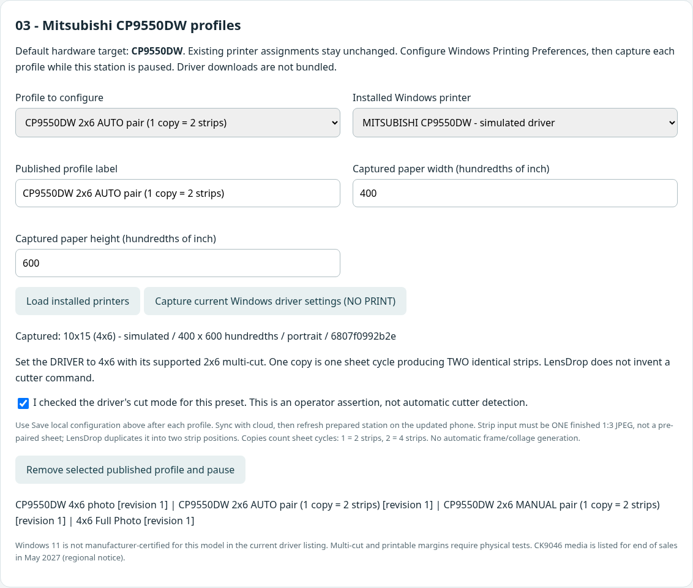

# LensDrop H5.2 - Mitsubishi CP9550DW
## Research, profile setup and controlled print testing
Version: 2026-11-20. Android: 0.2.0-alpha.6-h5.2 / code 7. Windows station: 0.1.1-alpha.h5.2.

**Engineering update, not hardware certification.** This package changes the Android print picker and Windows station. It does not change the cloud application, schema 5, nine-field job protocol, staff pairing, guest QR rules or the independent 58B3 Printer Lab. The new native code still needs GitHub compilation and real-device testing. Previously successful H5.1 builds do not validate this revision.

## 01 - Research findings and boundaries
The CP9550DW is now the preferred photo-printer model in new profile setup. Existing saved queues and pending jobs are not silently changed.

| Finding | Evidence | What it means |
|---|---|---|
| Normal 4x6 output | Mitsubishi operation manual, specification page: 102 x 152 mm, 346 x 346 dpi, Fine raster 1416 x 2152 dots. [S1] | Supported model-level format. The raster includes the driver's image area; it is not a promise that a 300 dpi artwork canvas should be stretched to those dimensions. |
| 2x6 multi-cut exists | Mitsubishi's 2010 CP-9550DW brochure explicitly advertises 2x6 multi-cut. This is a manufacturer-authored brochure hosted by AV-iQ. [S2] | Automatic strips are a legitimate capability to investigate, not an invented software cutter. The brochure does not identify Brian's installed driver, firmware or exact cut geometry. |
| Official driver availability | Mitsubishi lists CPD9550V x64 Ver.2.31_WT under Windows 10, and marks later OS versions unsupported. [S3] | Windows 11 remains a compatibility test, not a manufacturer-certified configuration. Do not disable driver-signature enforcement or other security protections to force an installation. |
| Media planning | Mitsubishi EMEA lists CK9046 among 9000-series media reaching end of sales in May 2027; regional/vendor conditions can differ. [S4] | Confirm local supply before relying on this model for future events. Existing stock does not become unusable on that date. |

The current operation manual lists older standard sizes but not the later brochure's strip feature. These sources are not treated as identical revisions. The official driver ZIP could not be downloaded in this execution environment because DNS failed; its internal guide and private cut settings were not inspected. No third-party driver binary or manufacturer firmware is bundled.

## 02 - Three explicit profiles
| Profile ID | Input | Output and copy meaning |
|---|---|---|
| `cp9550-photo-4x6` | One finished JPEG | One 4x6 sheet per copy; Contain, no software cropping. |
| `cp9550-strip-pair-auto` | ONE finished 1:3 strip JPEG, e.g. 600 x 1800, or its 3:1 rotation | Two identical strip placements per 4x6 sheet cycle. The captured Windows driver must already be set to a supported 2x6 multi-cut mode. |
| `cp9550-strip-pair-manual` | The same single-strip input | An uncut 4x6 sheet carrying two identical strips. Driver multi-cut must be OFF; trim manually. |

**One copy of a strip-pair profile means one sheet cycle and two strips. Two copies mean four strips.** Existing `max_copies` permissions continue to count job copies/sheet cycles, not individual strips. No odd single-strip output, mixed-client sheet pairing, strip collage designer, three/four-photo montage generation or external-editor automation is added here.

Do not submit a pre-paired 4x6 layout to the strip-pair profiles: it would be the wrong input. The phone and native renderer reject input whose long/short ratio differs from 3 by more than 0.03. A portrait sheet has two columns; a landscape sheet has two rows, with the strip rotated to fit. The phone shows the nominal pair before confirmation; actual driver bleed, printable margins and cut offsets must still be measured.

The 58B3 prints guest QR tickets only. It is not the photo printer and this update does not modify Printer Lab or add Bluetooth ticket printing.

## 03 - Build and update safely
1. Update the existing **LensDrop** private GitHub repository, not Luce-Printer-Lab-58. Merge the patch contents at the root, retaining `.git`, existing files and the persistent LensDrop Android signing secret. Alternatively use the complete source archive.
2. Include `.github`: both workflows gain focused tests. No new credentials, SDK version changes or automatic deployment are introduced.
3. Commit and push, then start a **new** `Run workflow` on the updated branch for **LensDrop Android APK** and **LensDrop Windows Print Station**. Re-running an old job builds its original commit. [S8]
4. Artifact names keep the H5 prefix. Android metadata must show `0.2.0-alpha.6-h5.2`, code `7`; Windows metadata must show `0.1.1-alpha.h5.2`. Check the new commit and checksums. A green build is not a physical-print test.
5. Pause the station, reconcile outstanding/uncertain jobs, exit its tray application, and back up the entire `%LOCALAPPDATA%\LuceStudio\LensDropPrintStation` folder. Extract the new portable build into a new program folder; keep all supporting files together. The station data folder and Windows-user-bound credentials stay in place.
6. Update Android in place with the same signing identity. Never uninstall or clear app data to solve a signing mismatch while queues matter. Export diagnostics first.
7. A running H5 cloud (`0.2.0-alpha.6-hostinger.5`) remains compatible. No Hostinger redeployment, initialization or database migration is needed for H5.2. An older H3/H4 server still needs the separate H5 upgrade procedure.

The original Hostinger deployment archive is retained unchanged in `deploy/`. It does not contain these local/native changes. Do not upload this full GitHub bundle to Hostinger.

## 04 - Install and verify the Windows printer first
Use the exact CP9550DW model and the manufacturer's official driver download page [S3]. Confirm the unit's full model designation and applicable driver/firmware with the supplier. Do not substitute a DW-S/DW-U/other model's package or flash guessed firmware.

Connect the printer by USB to the Windows station and install/configure its driver under the same Windows user that runs LensDrop. Confirm the installed queue appears in Windows. Load the correct matching paper/ribbon kit; the manufacturer's brochure identifies CK9046 for 4x6. [S2]

Print a controlled 4x6 test using the manufacturer's/Windows facilities before running event jobs. Record the Windows version, driver version, queue name, actual media, paper selection, orientation, cut option, output dimensions and result. No printer should be used for paid/event work merely because it appears in the dropdown.

## 05 - Configure 4x6 and strip modes
**Finish or reconcile old jobs before changing Windows Printing Preferences.** Older H5 generic jobs have no driver snapshot and can still depend on their queue's current defaults. The capture endpoint refuses to proceed while such unresolved legacy jobs exist.

### Normal 4x6
In Windows Printing Preferences, select the driver-supported 4x6 / 10x15 paper and turn multi-cut OFF. Choose the required quality and orientation. Leave driver copies at one; LensDrop applies the requested job copies separately.

In LensDrop, leave **Pause queue execution** and **Simulation only** checked. Save the LAN configuration if needed. Under **03 - Mitsubishi CP9550DW profiles**, choose **CP9550DW 4x6 photo**, load installed printers and explicitly select your queue. A uniquely matching CP9550 name may be preselected, but is not saved or enabled automatically.

Press **Capture current Windows driver settings (NO PRINT)**. Check the reported paper and orientation, acknowledge that you checked the cut mode, then press **Save local configuration**. Capture does not print and the checkbox is an operator assertion, not machine verification.

### Automatic 2x6 pair
Only proceed if the installed driver exposes a documented 2x6 multi-cut configuration for a 4x6 sheet cycle. Do not assume an arbitrary option named Type 1 or Type 2 means 2x6. Configure the driver accordingly, select **CP9550DW 2x6 AUTO pair**, capture, check the details, acknowledge and save.

The software preserves opaque driver settings through Windows DEVMODE APIs; it does not reverse engineer or edit undocumented Mitsubishi cutter bytes. The settings are bound to the exact queue and driver-file fingerprint. If the driver changes or a different queue is selected, recapture and revalidate. [S5]

The current preset intentionally requires a captured nominal 4x6 sheet area (with bounded driver bleed tolerance), not a standalone 2x6 paper size. If your driver only exposes a different form or needs different source geometry, stop and supply its settings screenshot/guide; do not force this preset.

### Manual-cut fallback
Set the driver back to normal 4x6, multi-cut OFF. Select **CP9550DW 2x6 MANUAL pair**, capture separately and save. This is an explicit alternative, never an automatic fallback behind a request that promised machine-cut strips.

All saved profiles can point to one physical CP9550DW queue because each stores its own settings snapshot. Only the public label, ID, revision, fit and effective paper dimensions are sent to the cloud/phone; the opaque snapshot stays local and is copied into accepted jobs. The driver ultimately controls which vendor settings are applied, so physical verification remains mandatory.

Changing a profile increments its revision. Removing and later recreating a profile must use a higher revision, preventing stale grants from matching a newly configured profile. Already accepted jobs retain their original settings and simulation flag.

Actual UI source in a browser test harness. Driver enumeration/capture are simulated; this is not a Windows hardware screenshot.

## 06 - Select and preview on Android
After saving profiles, press **Sync with cloud** on Windows. On Android choose **Prepare / refresh authorized station (online)** to obtain the updated profile list and permission grant.

Choose **Select JPEG / preview / print**, pick a test JPEG, then select the intended profile. For strips, use `calibration/STRIP_2x6_SINGLE_600x1800.jpg`. The preview must show TWO placements of that one strip. The copy selector explicitly states the resulting strip count. This is a layout preview, not color management or a driver-accurate soft proof.

Confirm one copy. The same existing job ID is used over Local, Cloud and Hybrid routes. Selection, source checksum, destination and profile revision are immutable; retrying a transport does not create another print. Hardware remains at the Windows station, never in Hostinger or the QR-ticket printer.

## 07 - Controlled acceptance sequence
Keep originals, sample paper and test records. Complete each gate before the next.

| Gate | Required observation |
|---|---|
| Build | Both new native builds succeed; correct versions and persistent Android signer confirmed. |
| Simulation | Phone selection, two-up preview, copy count and single station job match. No paper used. Simulation does not inspect the Windows cutter. |
| 4x6, one copy | Use `PHOTO_4x6_1200x1800.jpg`. Verify correct queue, orientation, scale and edges; no strip cut. |
| Auto pair, one copy | Use the single-strip fixture. Receive two separate strips from one sheet cycle; check top/bottom direction, divider cut, actual size and safe text region. |
| Manual pair, one copy | Receive one uncut sheet with two strips; verify manual trimming gives the intended result. |
| Two copies | Verify exactly two sheet cycles and four strips for a pair profile; hardware quantity is not inferred from the UI. |
| Profile isolation | Alternate 4x6 / auto / 4x6 / manual. Cutter behavior must follow each saved snapshot, not the latest global Windows preference. |
| Recovery | Disconnect network before acceptance, after acceptance and around submission. One job identity remains; uncertain physical outcomes are reviewed, not auto-reprinted. |
| Restore | Restart phone/station and confirm saved profiles, queues and permissions behave correctly. Backups must restore under the appropriate Windows user. |

The fixtures contain geometric markers and safe-area labels. They are not an ICC chart, manufacturer bleed specification or guaranteed physical ruler until printed scale has been calibrated. Never put irreplaceable text, faces or guest QR codes directly on the cut/trim edge.

A successful driver submission remains `submitted_unconfirmed`. It is not proof of paper output. Some Windows statuses do not establish physical completion; operator confirmation and the existing unknown-outcome handling remain. [S6]

## 08 - Troubleshooting
- **No multi-cut option:** do not enable the auto preset. Check the exact supported driver with Mitsubishi/dealer, or use the manual-cut profile explicitly.
- **`capture_4x6_sheet_not_single_2x6`:** the captured form is not a supported sheet-sized setup. Review driver paper selection; do not type guessed dimensions.
- **`resolve_legacy_jobs_before_driver_change`:** finish, cancel before submission or reconcile uncertain legacy jobs before capture. Do not delete the ledger.
- **`profile_changed_reselect` / retired revision:** refresh station permissions and create a new request only after inspecting the old request's state. Do not edit an existing job ID into another layout.
- **`failed_before_submit`:** inspect Windows queue/driver/media and recapture after a driver update. Retry only through the controlled pre-submission action.
- **`outcome_unknown`:** check the physical output and spooler. Do not blindly retry or send the same request to another station.
- **Output has wrong count/cut/trim:** pause. Compare driver screenshots, media, snapshot and one-copy test. The application does not infer cutter behavior from printer name or paper dimensions.

## 09 - Sources and provenance
Accessed 2026-11-20. These establish external facts; they do not certify the new implementation.

- [S1] Mitsubishi Electric Hong Kong, CP9550DW Operation Manual, printed p.21 (PDF page 24): https://www.mitsubishielectric.com.hk/uploads/download/doc/ib/68.pdf
- [S2] Mitsubishi Digital Electronics America, CP-9550DW brochure, copyright 2010, IP0001-01/10-WEB LITCP9550DW; manufacturer document mirrored by AV-iQ: https://cdn-docs.av-iq.com/brochure/CP-9550DW_Brochure.pdf
- [S3] Mitsubishi Electric global driver download table and later-OS footnote: https://www.mitsubishielectric.com/printer/dowmload-01/
- [S4] Mitsubishi Electric Printing EMEA, 9000 Series Media / End of Sales: https://mitsubishielectric-printing.com/en/about-us/news/news/9000-series-media-end-of-sales?PageSpeed=noscript
- [S5] Microsoft, PrinterSettings.GetHdevmode / SetHdevmode and PageSettings.SetHdevmode: https://learn.microsoft.com/en-us/dotnet/api/system.drawing.printing.printersettings.gethdevmode?view=windowsdesktop-10.0 ; https://learn.microsoft.com/en-us/dotnet/api/system.drawing.printing.printersettings.sethdevmode ; https://learn.microsoft.com/en-us/dotnet/api/system.drawing.printing.pagesettings.sethdevmode
- [S6] Microsoft, JOB_INFO_2 print status caveats: https://learn.microsoft.com/en-us/windows/win32/printdocs/job-info-2
- [S7] Android, app-update signing identity requirements: https://developer.android.com/google/play/app-updates
- [S8] GitHub, rerunning jobs retains the original commit: https://docs.github.com/en/actions/how-tos/manage-workflow-runs/re-run-workflows-and-jobs

The official manual specification page was visually inspected through the PDF screenshot tool. The AV-iQ brochure's parsed content was accessible, but its screenshot fetch failed with HTTP 502. Driver ZIP retrieval failed with container DNS errors. No binary driver, firmware, credentials, private photos or signing keys are redistributed.
